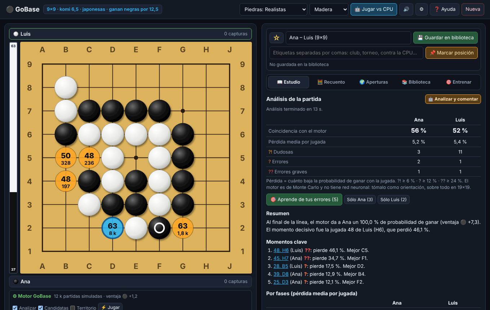

# GoBase

Analiza, comenta y entrena **tus partidas de go** en el navegador: variantes, SGF completo, motor propio de Monte Carlo,
análisis con informe, recuento, problemas de vida y muerte con defensa perfecta, biblioteca con marcadores y repaso
con repetición espaciada. Todo en **español** y en **un único archivo HTML**: sin servidor, sin cuentas y sin instalar
nada. Tus partidas se quedan en tu navegador. Hermana de [AjedrezBase](https://github.com/rkarillo-tech/ajedrezbase)
y [BackgammonBase](https://github.com/rkarillo-tech/backgammonbase).

### ▶️ [Abrir en el navegador](https://rkarillo-tech.github.io/gobase/) · [Descargar el HTML](https://github.com/rkarillo-tech/gobase/releases/latest/download/gobase.html) · [Guía de uso](GUIA.md)

> La versión web se puede **instalar como aplicación** (botón «⬇ Instalar» o «Añadir a pantalla de inicio» en el móvil)
> y entonces **funciona sin conexión**. Si prefieres el archivo suelto, guárdalo donde quieras y ábrelo con Chrome, Edge,
> Firefox o Safari. Todas las versiones están en [Releases](https://github.com/rkarillo-tech/gobase/releases).



## Qué incluye

| | |
| --- | --- |
| **Tablero** | 19×19, 13×13, 9×9 y 7×7; piedras realistas, planas o de alto contraste y 6 colores de tablero; coordenadas, números en las piedras, piedra fantasma y marca de ko |
| **Reglas** | Capturas, ko, suicidio prohibido y **superko posicional** (opcional); hándicap de 2 a 9 piedras en sus puntos clásicos; komi y reglas japonesas o chinas |
| **Variantes** | Árbol completo: variantes anidadas, promover, hacer principal, cortar; comentarios, símbolos `!` `?` `!?`… y valoración de la posición; marcas △ □ ○ ✕, letras y números |
| **SGF** | Lee y escribe SGF FF[4] de OGS, KGS, Fox, GoGoD, Sabaki…: colecciones, colocaciones (AB/AW/AE), marcas, codificaciones (CA) y propiedades desconocidas, que se conservan; también listas de jugadas sueltas (`D4 Q16` o `pd dp`) |
| **Motor** | Propio, de **Monte Carlo** (UCT + RAVE con partidas simuladas guiadas) en un Worker: probabilidad de ganar, ventaja estimada en puntos, mejores jugadas con su variante, candidatas en el tablero y **mapa de territorio** |
| **Análisis** | Analiza la partida (o una variante): marca `?!` `?` `??` midiendo cada jugada contra la mejor en la misma búsqueda, redacta comentarios en español (capturas, ataris, conexiones, puntos de la esquina, mejor alternativa y su línea) y dibuja el gráfico |
| **Informe** | Coincidencia con el motor, pérdida media, errores por fases (apertura, medio juego, yose), momentos clave y qué practicar; **🎯 Aprende de tus errores** |
| **Jugar contra la CPU** | 8 niveles, tu color, hándicap, komi, reglas y reloj con **byo-yomi** japonés; pasar, rendirse, deshacer y revancha; la CPU pasa y se rinde cuando toca, y al final se cuenta |
| **Recuento** | Territorio y prisioneros (japonesas) o área (chinas); el motor propone las piedras muertas y las corriges con un clic; estimación en vivo y ejercicio **¿Quién gana?** para aprender a contar |
| **Problemas** | Vida y muerte (formas de ojos) y capturas (escalera, red, contragolpe) resueltos por **lectores exactos**: la CPU defiende a la perfección y se acepta cualquier jugada que funcione; también colecciones de problemas en SGF |
| **Aperturas** | Explorador de **tus propias partidas** que reconoce la posición girada o reflejada (8 simetrías), puntos de la esquina, formaciones y consejos |
| **Biblioteca** | Guardas sólo lo que te interesa: ⭐ favoritas, etiquetas, buscador, búsqueda en comentarios, exportar a SGF, copias de seguridad y medidor de ocupación |
| **Marcadores y tarjetas** | 📌 Marca posiciones (idea, táctica, vida y muerte, forma, error típico, plan, yose) con nota y repásalas como tarjetas con repetición espaciada (1, 3, 7, 16, 35, 75 días) |
| **Estadísticas** | Con tu nombre: victorias por color y tamaño, coincidencia con el motor, errores por partida y en qué fase pierdes más; **ejercicios con los errores de todas tus partidas** |
| **Compartir** | Imagen PNG (también al portapapeles), impresión o PDF en **figuras de 50 jugadas numeradas** con comentarios, y enlace que abre la partida en una jugada |

## Cómo se usa

1. Pega un SGF (o jugadas sueltas) en **📖 Estudio** y pulsa **Importar**, abre un `.sgf` con **📂 Abrir .sgf** o juega directamente en el tablero.
2. Recórrelo con `←` `→`. Activa el motor con `E` para ver las mejores jugadas y, con `T`, el territorio.
3. Pulsa **🤖 Analizar y comentar** para marcar los errores, escribir comentarios y ver el informe; después, **🎯 Aprende de tus errores**.
4. Añade tus variantes, comentarios y marcas. Si la partida te interesa, **💾 Guardar en biblioteca**: a partir de ahí sus cambios se guardan solos.
5. Marca con **📌** (o `M`) las posiciones que quieras recordar y repásalas en **🎯 Entrenar › Tarjetas**.
6. Para practicar, **🤖 Jugar vs CPU** (9×9 es donde mejor juega) y los **🧩 Problemas** de 🎯 Entrenar.

Todo está explicado con ejemplos en la **[guía de uso](GUIA.md)**, que también está dentro de la aplicación (botón **❓ Ayuda** o tecla `?`).

## Atajos

`←` `→` jugada anterior / siguiente · `RePág` `AvPág` de 10 en 10 · `↑` `↓` cambiar de variante · `Inicio` `Fin` ·
`Espacio` reproducir · `P` pasar · `E` análisis on/off · `T` territorio · `H` pista · `N` números · `M` marcar posición ·
`?` ayuda · `Esc` cerrar · rueda del ratón sobre el tablero para avanzar y retroceder.

## Preguntas frecuentes

**¿Dónde se guardan mis partidas?** Sólo en tu navegador (IndexedDB). GoBase no se conecta a ningún servidor.
La biblioteca depende del navegador y de la dirección: no es la misma en la versión web que en el archivo descargado.
Para pasarla de un sitio a otro, usa **⬇ Copia de seguridad** y **⬆ Restaurar copia**.

**¿Se guarda todo lo que importo?** No. Importar o abrir un `.sgf` no guarda nada; sólo lo que guardas con 💾.

**¿Qué fuerza tiene el motor?** Es un motor de Monte Carlo sin red neuronal, escrito para GoBase. En 9×9 y 13×13 juega
con sentido y señala bien los errores claros; en 19×19 es mucho más débil que KataGo o Leela Zero. Tómalo como una
orientación y, para revisar una partida importante, descarga el SGF y ábrelo en esos programas.

**¿Cómo sé que los problemas están bien?** Cada problema lo resuelve un lector exacto (vida y muerte en una zona cerrada
y lectura de capturas). Las pruebas automáticas comprueban la solución de cada uno, y en la aplicación se acepta
cualquier jugada que funcione.

**¿Puedo usarlo, modificarlo o compartirlo?** Sí, con licencia MIT (ver abajo).

**¿Hay soporte?** Es un proyecto personal que se comparte tal cual, sin garantía.

## Licencia

[MIT](LICENSE) © 2026 Rafael Karino Arillo ([rkarillo-tech](https://github.com/rkarillo-tech)).
Puedes usarlo, copiarlo, modificarlo y distribuirlo libremente, manteniendo el aviso de autoría.
Todo el código es propio y no usa bibliotecas externas: ver [THIRD_PARTY_NOTICES.md](THIRD_PARTY_NOTICES.md).

---

## Para desarrolladores

`index.html` se genera a partir de `src/` con un script sin dependencias. No hay compilación ni paquetes npm en la aplicación.

```
build.py              Une src/ en index.html y genera sw.js y GUIA.md
VERSION               Número de versión
index.html            La aplicación completa (generada: no editar a mano)
manifest.webmanifest  Datos para instalarla como aplicación
sw.js                 Service worker: uso sin conexión (generado desde src/sw.js)
src/template.html     Plantilla con estilos y marcadores {{...}}
src/core.js           Reglas, coordenadas, hándicap, recuento, Benson y lectores exactos (capturas y vida y muerte)
src/sgf.js            Árbol de variantes y lector/escritor SGF
src/engine.js         Motor de Monte Carlo (UCT + RAVE), territorio y piedras muertas
src/worker.js         Mensajes del Worker del motor (se une a core.js y engine.js)
src/problems.js       Problemas incluidos y datos de apertura
src/board.js          Dibujo del tablero en SVG (tablero, miniaturas, impresión, PNG)
src/app.js            Interfaz, motor, análisis e informe, editor, marcas y exportación
src/play.js           Jugar contra la CPU, reloj y recuento
src/library.js        Biblioteca (IndexedDB), marcadores, búsqueda, estadísticas, ficheros y explorador
src/train.js          Problemas, errores de tus partidas, tarjetas, ejercicio de contar y arranque
src/help.html         Guía de uso (también se exporta a GUIA.md)
assets/               Icono (icon.svg y sus PNG, generados con tools/gen_icons.js) y captura
notas/                Notas de cada versión
tests/                Pruebas del núcleo (Node) y de extremo a extremo (Playwright)
```

**Principios:** un solo archivo que funciona con doble clic; nada sale del navegador; nada se guarda sin que el usuario
lo pida; los problemas se verifican con lectores exactos.

```bash
python3 build.py                                   # genera index.html, sw.js y GUIA.md
npm install --no-save playwright@1.49.1
npx playwright install chromium
tests/run_all.sh                                   # todas las pruebas
```

Para publicar una versión: sube `VERSION`, añade `notas/vX.Y.Z.md`, ejecuta `python3 build.py` y crea una
Release `vX.Y.Z` en GitHub; la acción adjunta `gobase.html` y su huella SHA-256.
